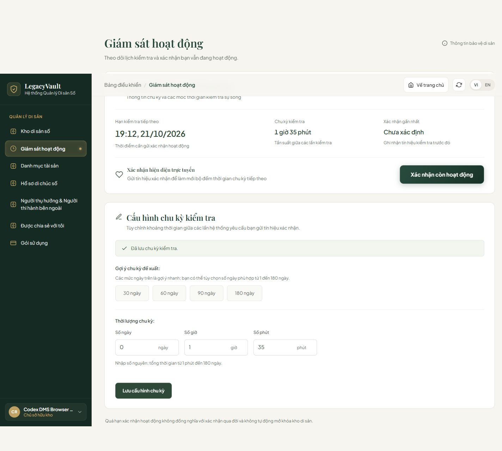
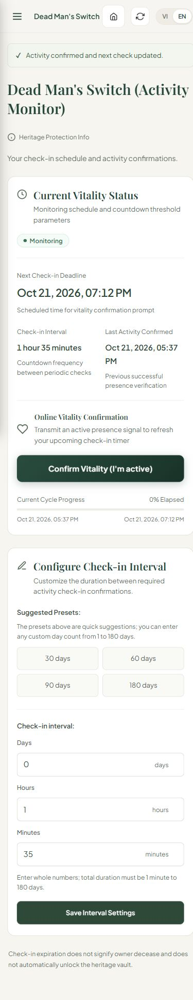

# DMS minute follow-up — 21/10/2026

## Scope
Fix frontend PS-91 minute duration handling and obsolete backend-pending copy. Keep the existing Staff handover link label cleanup; this is not completion of PS-95–105.

- Reject present but invalid minute values and inconsistent day/minute pairs; accept legacy day-only reads, including history over 180 days. New configuration remains limited to 180 days.
- Parse exact total minutes into display fields; save/check-in/reload retain the duration.
- Remove obsolete VI/EN backend-pending warnings and shorten the duration hint.
- Test the reader directly, malformed save receipts (no success, draft retained), UI VI/EN, and valid/invalid duration boundaries. Correct the old 30-day fixture to total 43200 minutes.

## Independent checks
- Full frontend: 1030/1030 passed, 27 suites, no failure/skip.
- DMS focused: 20/20 passed. Lint and build passed; build retains the existing large-bundle warning.
- Real browser desktop 1440x1000 VI and mobile 390x844 EN, with actual Spring Boot and SQL Server local database. No fixture in the screenshots below.
- User authorized creating a new synthetic test account, vault and adult beneficiary through public APIs. No existing credentials, roles or business records were reset.
- Browser saved 1 hour 35 minutes; reload returned 1 hour 35 minutes; check-in succeeded without changing duration. Mobile document width equaled viewport width (390px).
- Read-only SQL query after browser check-in returned MONITORING, check_interval_days=NULL, check_interval_minutes=95, DATEDIFF(MINUTE,last_check_in_at,next_check_at)=95.
- Existing Owner account was TRIGGERED. Attempted configuration was correctly rejected by BE, draft remained, no success banner; reload retained the original 1-day setting. No DB bypass or forced cancellation was used.

## Limits and corrected handover notes
- The full Staff–Legal–Beneficiary COURT workflow was not run end-to-end in this follow-up. Shared-with-me public redeem/received-assets dependencies remain outside this diff.
- PS-103 does not mean COURT upload is missing: basis-dossier versions already accept multipart PDF/JPEG/PNG. Death/original-will attachments and authorized file reads need their specific contract.
- Sheet bug 19 means removing the top-right refresh button, not F5 route loss; it is not implemented here.
- Earlier Anti report and screenshots are historical, not proof of this final revision. Browser fixture evidence is separate from the real screenshots above.
- No merge or Jira status change is authorized by this handover.
