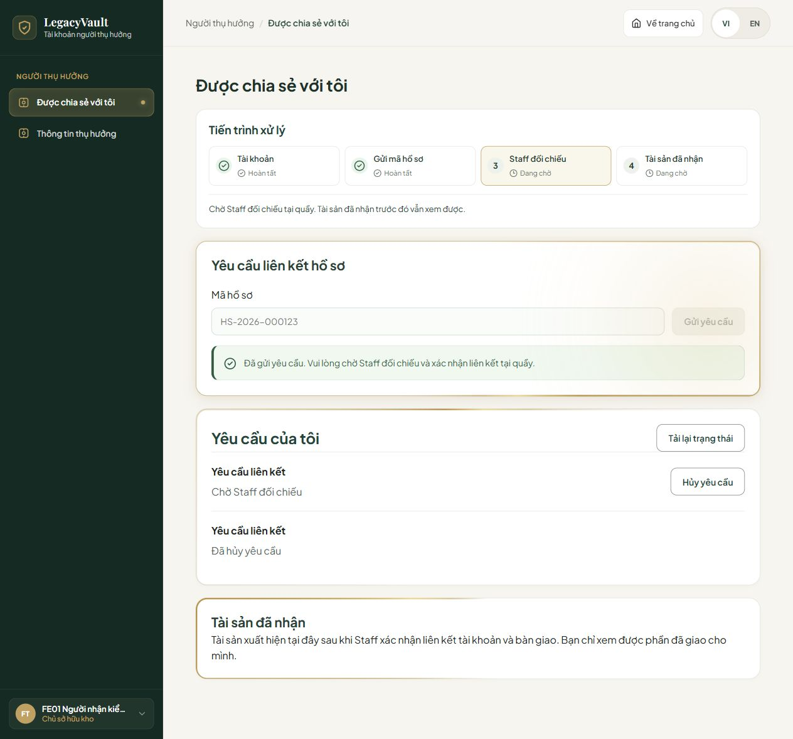
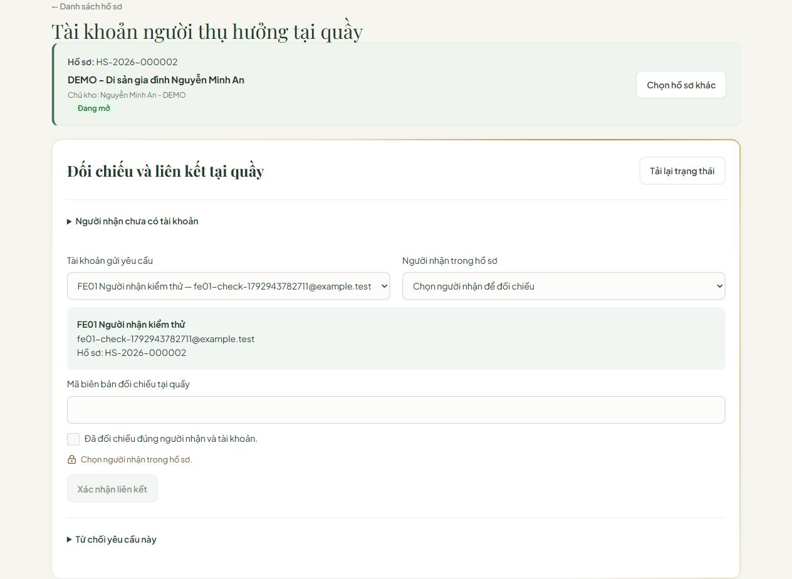

# FE-01 — Nối API BE-01 và nghiệm thu Staff / Legal / Bene

Ngày 25/10/2026. Nền develop c97836b, đã gồm PR #215 của Long và sửa hạn mức bdc406e.

## Hành vi
- Entry point dùng adapter BE-01 thật. Staff tạo account chưa liên kết; account roles=[] đăng nhập vào Shared with me, không được cấp quyền Owner hoặc đọc tài sản.
- Bene gửi caseCode, xem/hủy yêu cầu của mình. API không trả mã hồ sơ/UUID account trong danh sách yêu cầu; FE không suy diễn hoặc dựng dữ liệu đó. Mỗi yêu cầu hiển thị mã tham chiếu riêng.
- Staff đọc yêu cầu theo ca được giao, đối chiếu tên/email với người tại quầy và recipient. Lưu identity attestation trước khi approve; nếu lưu lỗi thì không gọi approve. BE lấy account từ request đã lưu, body chỉ có beneficiaryId. Reject không thu thập lý do vì API không lưu trường đó.
- Chặn gửi trùng, hủy request khi đổi ngữ cảnh, tải lại sau lỗi chưa rõ kết quả; thông báo lỗi hạn mức, mã không khả dụng, email đã có tài khoản.
- Giữ hướng dẫn theo bước Staff/Legal/Bene. Truy cập một màn không đồng nghĩa bước đã hoàn tất; chỉ khóa thao tác có điều kiện chưa đạt và nêu lý do.
- Staff nhập người mới C theo văn bản Tòa án, không yêu cầu account tại bước tiếp nhận. Legal phê duyệt và mở khóa là hai bước riêng. Khi bàn giao, C chưa linked vẫn hiện cùng lý do khóa; A đủ điều kiện vẫn được giao riêng. Linked không đồng nghĩa DELIVERED.
- Bao gồm các thay đổi FE có sẵn trên 5196: bố cục bảng/khung cuộn, ngữ cảnh hồ sơ/phiên, xác nhận người nhận, tiến độ/đóng hồ sơ và hướng dẫn. Không đưa các thay đổi BE local, cấu hình demo, bí mật hoặc trang HTML review vào PR này.

## Bằng chứng
- Sau review của Dương: cập nhật đúng 7 fixture eligible-assets trong reviewStaffRound3.test.mjs theo BE-02 (accountLinked=true, deliverable=true, blockedReason=null). Không sửa logic bàn giao hoặc assertion. File đạt 10/10; toàn bộ npm test đạt **1325/1325**, 0 skipped. Test có máy chủ local cần quyền kết nối loopback; lượt bị chặn EACCES không được tính là kết quả xác minh cuối.
- 292/292 kiểm thử FE phạm vi thay đổi trên checkout PR đạt, gồm Staff, Legal, Bene, hướng dẫn, phân bổ C, confirmation/progress/archive và profile refresh.
- 35/35 kiểm thử bổ sung auth/session đạt. Cập nhật assertion cũ từ chối roles=[] theo hợp đồng account chưa liên kết BE-01; vẫn từ chối role lạ/sai định dạng.
- Lint mọi file JS/JSX thay đổi và build production đạt. Build còn cảnh báo chunk lớn.
- 6/6 StaffLinkRequestHttpSqlServerTest đạt trên SQL Server thực: account chưa linked đăng nhập, gửi yêu cầu, approve/reject, concurrency, rollback và hạn mức không đếm yêu cầu hết hạn.
- 6/6 kiểm thử SQL bổ sung CourtRecipientsHttpSqlServerTest, FinalCourtHandoverHttpSqlServerTest, ReceivedAssetSqlServerTest đạt. Database test riêng ngẫu nhiên được bộ test tự tạo/dọn, không dùng hồ sơ demo để phê duyệt.
- Backend demo 8082 khởi động thành công, Flyway áp dụng V50–V52 thành công; FE giữ cổng5196.
- Thử trực tiếp qua API demo và trình duyệt5196: tạo account thử chưa linked → đăng nhập roles=[] → gửi mã HS-2026-000002 → Staff nhìn thấy đúng request → Bene hủy thành công. Đã hủy request thử, giữ lịch sử và account thử; không gắn account thử vào recipient hoặc bàn giao tài sản demo.
- Staff mobile: viewport390px, chiều rộng nội dung375px (trừ scrollbar), không tràn ngang.

## Giới hạn
Chưa thực hiện approve/bàn giao trên các hồ sơ demo đang dùng để tránh thay đổi phiên diễn tập của người dùng. Các bước quyết định và quyền đọc đã kiểm tra trong database SQL Server test riêng, cùng kiểm thử component/adapter FE; không tuyên bố đã bấm toàn bộ luồng đó trong trình duyệt demo. PR chưa merge.
