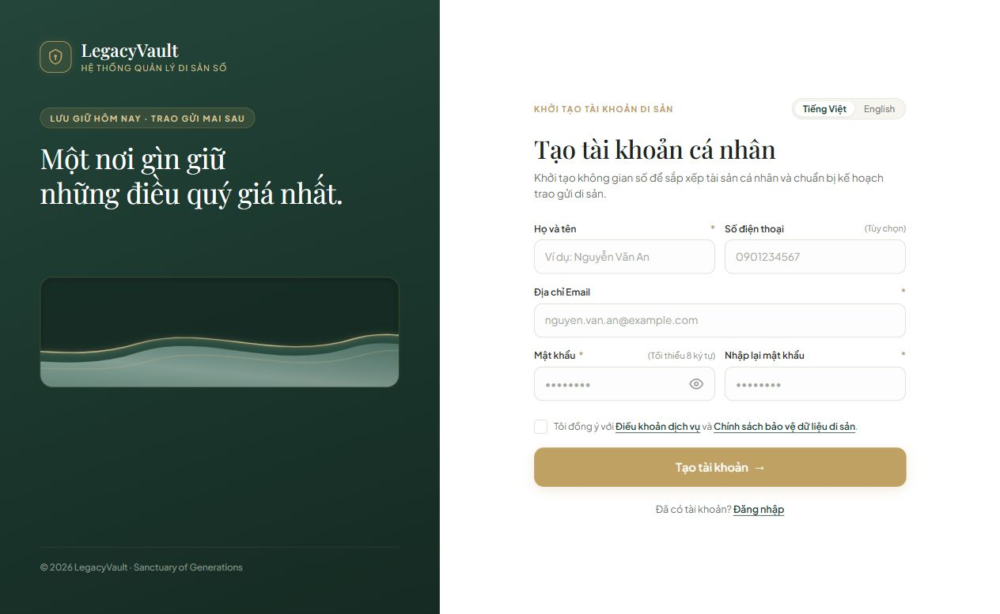
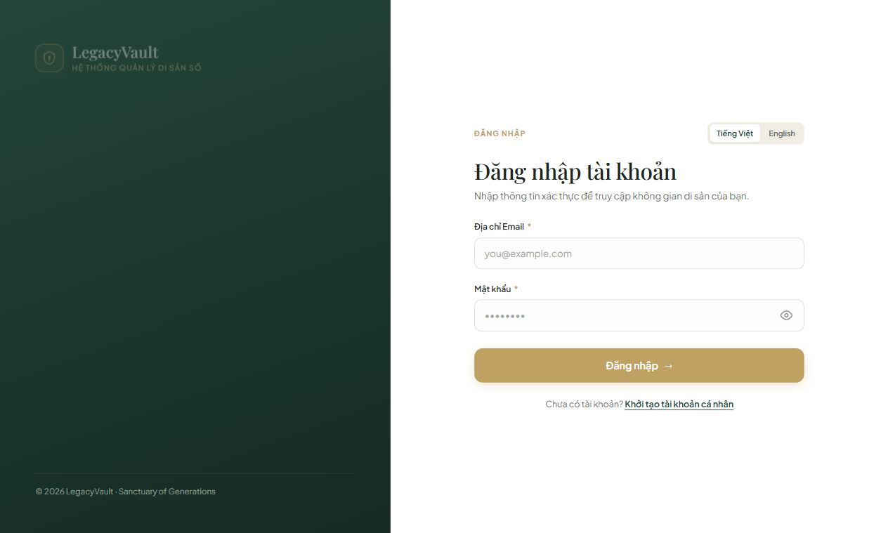
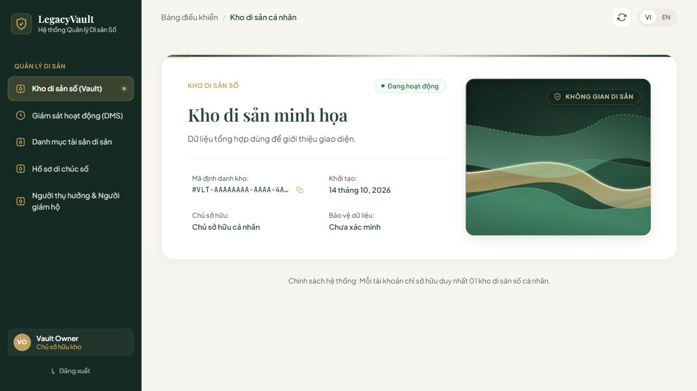
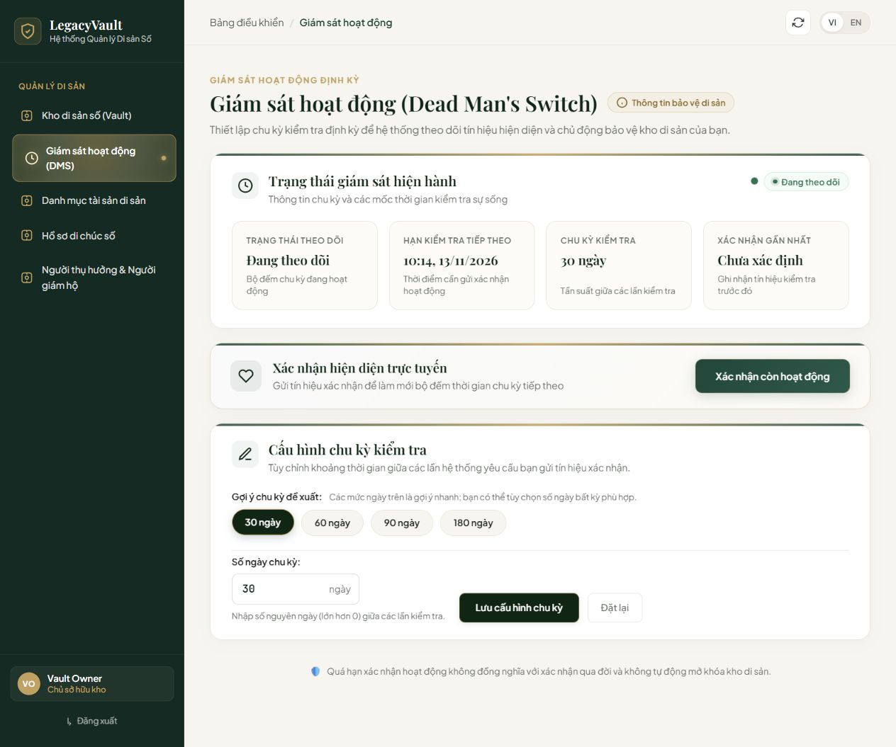
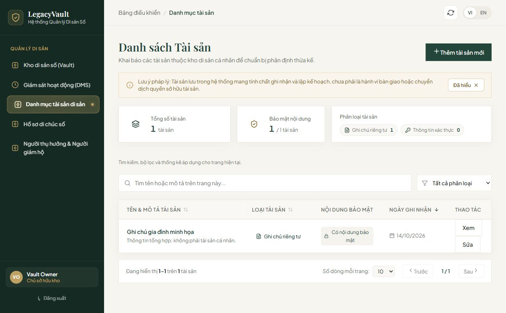
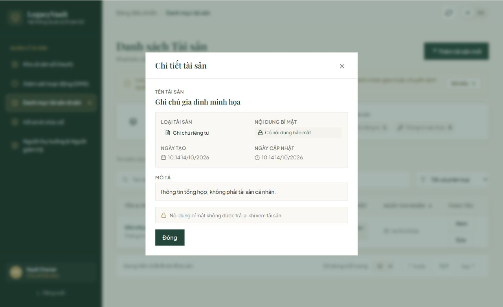
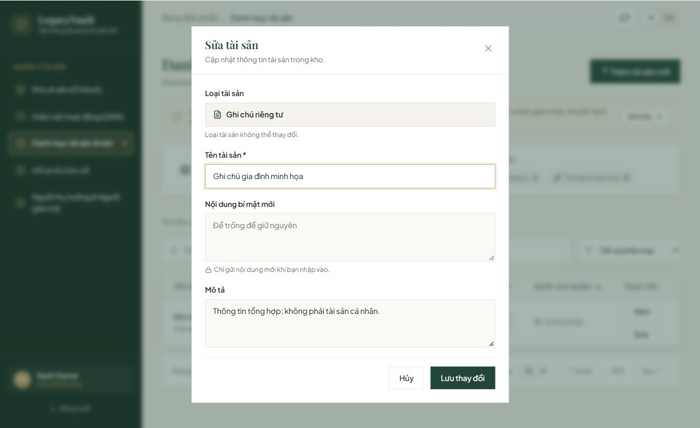
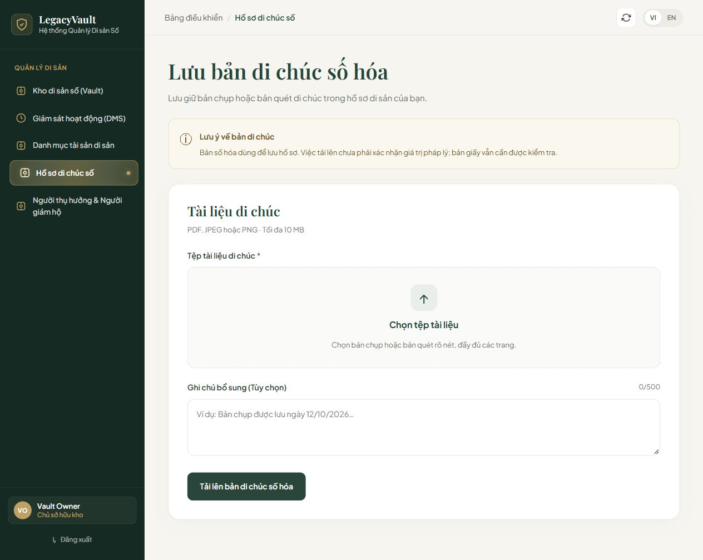
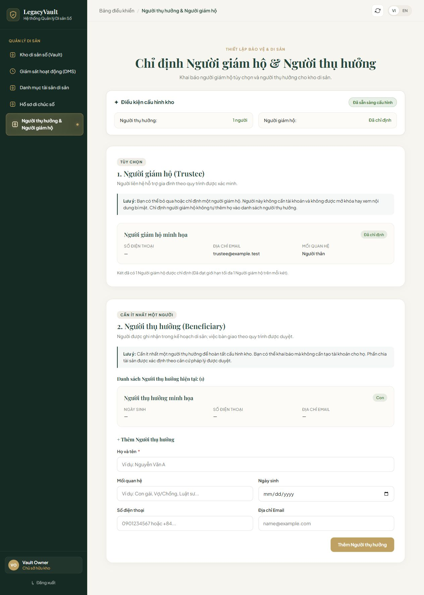

# Thư viện giao diện FE PS-1–8

[Quay lại README nhóm](../../README.md).

Ảnh chụp ngày **14/10/2026**, ngôn ngữ tiếng Việt, trình duyệt desktop với chiều rộng 1280 px; ảnh toàn trang có chiều cao khác nhau. Nguồn code: [develop tại ad9eea5](https://github.com/Abaddon8386/Legacy_Vault/tree/ad9eea5ae6577708b1e3b5fad3780c627b2bf755).

**Môi trường: FE + API mô phỏng, dữ liệu tổng hợp.** Chưa phải bằng chứng kết nối BE/SQL Server thật hoặc hoàn thành toàn bộ acceptance criteria. Tên, email và mã kho hiển thị đều là dữ liệu minh họa. Ảnh phản ánh phiên bản đã tích hợp, có thể gồm sửa đổi dùng chung từ các PR sau.

| Ticket | Màn hình/trạng thái chụp | PR đưa code vào bản tích hợp | Ảnh |
| --- | --- | --- | --- |
| [PS-1](https://thaithai9785.atlassian.net/browse/PS-1) | Biểu mẫu đăng ký chưa nhập/chưa gửi | [#7](https://github.com/Abaddon8386/Legacy_Vault/pull/7) | [Đăng ký](ps-1-register.jpg) |
| [PS-2](https://thaithai9785.atlassian.net/browse/PS-2) | Biểu mẫu đăng nhập chưa nhập | [#12](https://github.com/Abaddon8386/Legacy_Vault/pull/12) | [Đăng nhập](ps-2-login.jpg) |
| [PS-3](https://thaithai9785.atlassian.net/browse/PS-3) | Kho đã khởi tạo | [#9](https://github.com/Abaddon8386/Legacy_Vault/pull/9), tích hợp qua [#12](https://github.com/Abaddon8386/Legacy_Vault/pull/12) | [Kho di sản](ps-3-vault.jpg) |
| [PS-4](https://thaithai9785.atlassian.net/browse/PS-4) | DMS đang theo dõi, chu kỳ 30 ngày | [#14](https://github.com/Abaddon8386/Legacy_Vault/pull/14) | [DMS](ps-4-dms.jpg) |
| [PS-5](https://thaithai9785.atlassian.net/browse/PS-5) | Danh mục có một tài sản minh họa | [#11](https://github.com/Abaddon8386/Legacy_Vault/pull/11), bổ sung tích hợp trong [#15](https://github.com/Abaddon8386/Legacy_Vault/pull/15) | [Danh mục tài sản](ps-5-assets.jpg) |
| [PS-6](https://thaithai9785.atlassian.net/browse/PS-6) | Xem chi tiết và biểu mẫu sửa; nội dung bí mật không trả lại | [#15](https://github.com/Abaddon8386/Legacy_Vault/pull/15) | [Chi tiết](ps-6-detail.jpg) · [Sửa](ps-6-edit.jpg) |
| [PS-7](https://thaithai9785.atlassian.net/browse/PS-7) | Biểu mẫu tải lên chưa chọn tệp; có lưu ý pháp lý | [#16](https://github.com/Abaddon8386/Legacy_Vault/pull/16) | [Tải bản di chúc](ps-7-will-upload.jpg) |
| [PS-8](https://thaithai9785.atlassian.net/browse/PS-8) | Một người giám hộ và một người thụ hưởng minh họa; kho sẵn sàng cấu hình | [#17](https://github.com/Abaddon8386/Legacy_Vault/pull/17) | [Người giám hộ và thụ hưởng](ps-8-beneficiaries.jpg) |

## Xem ảnh đầy đủ

### PS-1 — Đăng ký

### PS-2 — Đăng nhập

### PS-3 — Kho di sản

### PS-4 — Giám sát hoạt động

### PS-5 — Danh mục tài sản

### PS-6 — Xem và sửa tài sản

### PS-7 — Tải bản di chúc số hóa

Ảnh này chỉ minh họa biểu mẫu, chưa thể hiện kết quả tải lên. Không hiển thị SHA-256 hoặc phần thông tin kỹ thuật trong giao diện người dùng.

### PS-8 — Người giám hộ và người thụ hưởng

## Bổ sung ảnh cho PR tiếp theo

Trong mô tả PR FE, thêm ảnh trước/sau khi phù hợp, tên màn hình, trạng thái đang chụp và môi trường API mô phỏng hoặc API thật. Dùng dữ liệu minh họa; không đưa thông tin cá nhân, mật khẩu, token hay nội dung bí mật vào ảnh. Khi giao diện thay đổi, cập nhật ảnh cùng ngày chụp và commit nguồn để người review đối chiếu đúng phiên bản.
